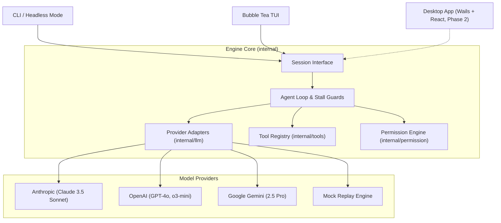

# Forge 🔨

**Forge** is a fast, robust, terminal-first AI coding agent engineered in Go.

It gives developers an autonomous programming partner directly in the terminal—capable of exploring codebases, editing files with diff previews, and executing test suites in autonomous fix loops.

```
   ___                            
  / __\___  _ __ __ _  ___        
 / _\/ _ \| '__/ _` |/ _ \       
/ / | (_) | | | (_| |  __/       
\/   \___/|_|  \__, |\___|       
               |___/              
```

---

## Highlights

- **Provider Agnostic**: Seamless first-class support for **Anthropic** (Claude 3.5 Sonnet), **OpenAI** (GPT-4o, o3-mini), **Google Gemini** (Gemini 2.5 Pro, Flash), and an offline deterministic **Mock Replayer**.
- **Autonomous Fix Loop**: Dispatches builds and test suites, isolates errors, inspects code, applies targeted edits, and re-verifies until tests pass.
- **Safety First (`SEC-1`–`SEC-6`)**: Four permission policies (`ask`, `accept-edits`, `plan`, `yolo`), dangerous command interception, process-tree isolation, and zero project credentials.
- **Interactive Terminal UI**: Bubble Tea TUI featuring live syntax rendering, colorized unified diff previews, real-time command streaming, and tool card toggling (`Ctrl+O`).
- **Semantic Themes**: Built-in support for `dark`, `light`, `catppuccin-mocha`, `tokyo-night`, `auto` terminal background detection, and `monochrome` (`NO_COLOR`).
- **Scriptable Headless Mode**: Run directly in CI/CD pipelines or shell scripts via `forge "prompt" --yes`.
- **Zero Runtime Dependencies**: Single static Go binary (`CGO_ENABLED=0`), under 20MB, with sub-100ms startup times.

---

## Architecture

Forge enforces a strict decoupled design: the core agent engine never imports Bubble Tea, lipgloss, or frontend packages. It interacts exclusively through a typed, JSON-serializable `Session` interface and `Event` stream.



For detailed component designs and execution flowcharts, see [docs/architecture.md](docs/architecture.md).

---

## Quickstart

### 1. Installation

#### Pre-built Binaries
Download the latest binary for your operating system from GitHub Releases:
- Linux (`amd64`, `arm64`)
- macOS (`amd64`, `arm64`)
- Windows (`amd64`, `arm64`)

#### Build from Source
```bash
git clone https://github.com/ayushpatil0810/forge.git
cd forge
go build -o bin/forge ./cmd/forge
```

### 2. Configure Your API Key
Set the environment variable for your preferred provider:

```bash
# Anthropic (Default)
export ANTHROPIC_API_KEY="sk-ant-..."

# OpenAI
export OPENAI_API_KEY="sk-proj-..."

# Google Gemini
export GEMINI_API_KEY="..."
```

### 3. Run Forge

#### Interactive Mode (TUI)
Launch Forge in your current repository:
```bash
forge
```

#### Deterministic Demo (No API Key Required)
Run a scripted 60-second demonstration fixing a boundary condition bug:
```bash
forge --demo
```

#### Headless Mode (One-Shot Execution)
Automate a task directly from your shell:
```bash
forge --yes "Run the test suite, find failing tests, and fix them"
```

---

## Permission Modes & Safety

Forge provides four permission policies to give you exact control over tool execution:

| Mode | Writes / Edits | Safe Bash Commands | Dangerous Commands | Usage |
| :--- | :--- | :--- | :--- | :--- |
| `ask` *(Default)* | Prompts | Prompts | Prompts | Maximum safety; confirm every change |
| `accept-edits` | Auto-allows | Prompts | Prompts | Fast editing; confirms commands |
| `plan` | Denied | Denied | Denied | Read-only exploration and architecture analysis |
| `yolo` | Auto-allows | Auto-allows | Prompts | Unattended execution (`--yolo` flag only) |

### Key Safety Guarantees
- **SEC-1**: File contents, tool outputs, and command outputs are treated as untrusted data, never as system instructions.
- **SEC-2**: The `yolo` mode is deliberately unreachable via in-app mode cycling (`Tab`). It can only be activated at startup via `--yolo` and displays a persistent warning banner.
- **SEC-3**: Dangerous command heuristic intercepts destructive operations (`rm -rf /`, `git reset --hard`, `git push --force`, `dd`, `curl|sh`, tampering with `.git/` or `.env*`).
- **SEC-6**: API keys and tokens are never read from or written to project-level configuration files.

---

## Configuration

Forge uses a 5-layer configuration hierarchy:
**CLI Flags** > **Environment Variables** (`FORGE_*`) > **Project Config** (`.forge/config.json`) > **User Config** (`~/.forge/config.json`) > **Defaults**.

To inspect the effective resolved configuration for your current workspace:
```bash
forge config
```

For the complete schema, environment variables, and precedence table, see [docs/configuration.md](docs/configuration.md).

---

## Status & Progress Matrix

| Component | Status | Details |
| :--- | :--- | :--- |
| **Slice 0: Skeleton & CI** | `DONE` | Multi-OS CI, Makefile, linting, race-clean suite |
| **Slice 1: Core Contracts** | `DONE` | `Session`, `Event` streaming, mock replayer, loop guards |
| **Slice 2: Chat & Streaming** | `DONE` | Bubble Tea interactive TUI, markdown rendering |
| **Slice 3: Read-Only Tools** | `DONE` | `read_file`, `list_dir`, `grep`, `glob`, prompt injection defenses |
| **Slice 3b: Multi-Provider** | `DONE` | OpenAI verified live; Anthropic and Gemini adapters implemented |
| **Slice 4: File Editing** | `DONE` | Exact string replacement (`edit_file`), unified diff review cards |
| **Slice 5: Autonomous Fix Loop** | `DONE` | Native shell execution, process group kill, stall guard |
| **Slice 6: Hardening & Release** | `DONE` | Layered config, themes, error guidance, goreleaser, 6 OS targets |
| **Desktop App (Wails)** | `PARKED` | Planned for Phase 2 |
| **LSP Integration** | `PARKED` | Planned for Phase 2 |

---

## Development & Testing

Run the full race detector test suite:
```bash
go test -race ./...
```

Run code linter:
```bash
go vet ./...
```

Test autonomous fix loop against sample fixtures:
```powershell
# PowerShell
.\scripts\try-fixture.ps1 -Fixture boundary

# Bash
./scripts/try-fixture.sh boundary
```
