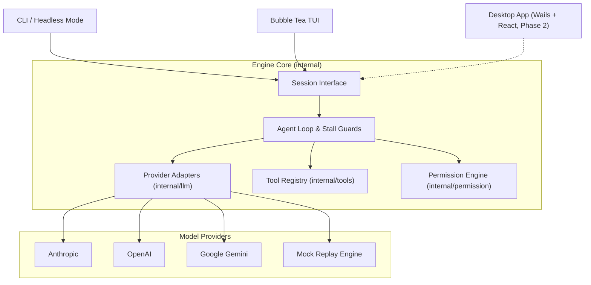

# Forge

**Forge** is a fast, robust, terminal-first AI coding agent engineered in Go.

It gives developers an autonomous programming partner directly in the terminal—capable of exploring codebases, editing files with diff previews, executing test suites in autonomous fix loops, and providing atomic undo checkpoints.

```
   ___                            
  / __\___  _ __ __ _  ___        
 / _\/ _ \| '__/ _` |/ _ \       
/ / | (_) | | | (_| |  __/       
\/   \___/|_|  \__, |\___|       
               |___/              
```

---

## Highlights

- **Multi-Provider Architecture**: First-class support for **OpenAI** (verified live), **Anthropic** and **Google Gemini** (contract-tested, live verification pending), local models via **Ollama**, and an offline deterministic **Mock Replayer**.
- **Shadow Git Checkpoints & Undo**: Automatic snapshot before mutating tool calls. Instant rollback via `/undo` or `forge undo` without touching user commit history.
- **Autonomous Fix Loop**: Dispatches builds and test suites, isolates errors, inspects code, applies targeted edits, and re-verifies until tests pass.
- **Safety First (`SEC-1`–`SEC-6`)**: Four permission policies (`ask`, `accept-edits`, `plan`, `yolo`), dangerous command interception, protected path enforcement (`.git/`, `.env*`, `.ssh/`), process-tree isolation, and zero project credentials.
- **Interactive Terminal UI**: Bubble Tea TUI featuring live syntax rendering, colorized unified diff previews, real-time command streaming, and tool card toggling (`Ctrl+O`).
- **Semantic Themes**: Built-in WCAG 2.1 compliant themes (`dark`, `light`, `catppuccin-mocha`, `tokyo-night`), auto background detection, and monochrome fallback (`NO_COLOR`, `TERM=dumb`).
- **Scriptable Headless Mode**: Canonical `forge run "prompt"` with structured output (`--output text|json|stream-json`), turn limits, and standardized exit codes.
- **Zero Runtime Dependencies**: Single static Go binary (`CGO_ENABLED=0`), under 20MB, with sub-100ms startup times.

---

## Provider Support Matrix

| Provider | Status | Live Verification |
| :--- | :--- | :--- |
| **OpenAI** | Production ready | **Verified live** (explore, edit, autonomous fix loop) |
| **Anthropic** | Implemented | Contract-tested; experimental, not live-verified |
| **Google Gemini** | Implemented | Contract-tested; experimental, not live-verified |
| **Ollama (Local)** | Local runtime | Contract-tested; zero-cost local open weights |
| **LM Studio (Local)** | Local runtime | Contract-tested; OpenAI-compatible local server |
| **Mock Replayer** | Production ready | Verified in CI test suite |

Forge does not ship a model menu. On first launch you type the model ID from your provider. See [docs/providers.md](docs/providers.md) and [docs/local-models.md](docs/local-models.md).

---

## Architecture

Forge enforces a strict decoupled design: the core agent engine never imports Bubble Tea, lipgloss, or frontend packages. It interacts exclusively through a typed, JSON-serializable `Session` interface and `Event` stream.



For detailed component designs and execution flowcharts, see [docs/architecture.md](docs/architecture.md).

---

## Quickstart

### 1. Installation

#### Pre-built Binaries
Download the latest binary for your operating system from GitHub Releases:
- Linux (`amd64`, `arm64`)
- macOS (`amd64`, `arm64`)
- Windows (`amd64`, `arm64`)

#### Build from Source
```bash
git clone https://github.com/ayushpatil0810/forge.git
cd forge
go build -o bin/forge ./cmd/forge
```

### 2. First launch

Open Forge in the repository you want to work in:

```bash
forge
```

When a hosted provider has no saved key, Forge opens a setup screen:

1. Choose a provider: Anthropic, OpenAI, Gemini, Ollama, or LM Studio.
2. Paste an API key for a hosted provider. The key is stored in the OS keychain and is not written to a config file. Ollama and LM Studio do not ask for a key.
3. Type the model ID you want to use, exactly as your provider publishes it, and press Enter.

You do not set an environment variable to open the app. If `ANTHROPIC_API_KEY`, `OPENAI_API_KEY`, or `GEMINI_API_KEY` is already set, that value is used instead of the saved key.

After setup, the chat screen is where you send messages. These commands reopen setup later:

| Command | What it does |
| :--- | :--- |
| `/settings` | Choose the provider again, replace the API key, and type a model ID. |
| `/models` | Switch provider and type a model ID. A provider that already has a saved key skips the key step. |
| `/model <id>` | Switch to that model ID immediately. |

`forge run "prompt"` and `forge "prompt"` do not open the setup screen. Run `forge` once so a provider, model, and key are saved, or set that provider's environment variable, before a headless run.

### 3. Other ways to run

#### Deterministic Demo (No API Key Required)
Run a scripted 60-second demonstration fixing a boundary condition bug (works without any external toolchain or Go installed):
```bash
forge --demo
# Or run with instant speed for validation
forge --demo --demo-speed 0 --yes
```

#### Headless Mode (One-Shot & Automation)
Run commands directly from terminal scripts or CI pipelines using canonical `forge run`:
```bash
# Basic run
forge run "Run the test suite and fix failing boundary conditions" --yes

# JSON streaming output with custom permission policy and turn budget
forge run "Analyze code quality" --output json --permission-mode plan --max-turns 10
```
For complete headless options, JSON schemas, and exit codes, see [docs/headless.md](docs/headless.md).

#### Checkpoints & Atomic Undo
Forge creates isolated shadow Git checkpoints before any tool mutates files. You can inspect or roll back changes at any time without touching your repository history:
```bash
# In TUI session:
/checkpoints          # List recent checkpoints
/undo                 # Roll back last agent turn
/restore <id>         # Roll back to specific checkpoint

# From CLI:
forge checkpoints list
forge undo
forge checkpoints restore <id>
```
For architecture details and isolation guarantees, see [docs/checkpoints.md](docs/checkpoints.md).

---

## Session Persistence & Resume

Forge automatically persists conversation sessions, tool invocations, tokens, and costs to an embedded SQLite database (`~/.forge/sessions.db`) with zero external daemon requirements.

```bash
# Resume most recent session in current workspace
forge --resume

# Resume a specific session by ID
forge --resume s_1730000000_abcdef

# In active TUI:
/resume               # Open interactive session picker
/resume <id>          # Switch directly to session

# Manage stored sessions from CLI:
forge sessions list          # List sessions for current workspace
forge sessions list --all    # List sessions across all workspaces
forge sessions show <id>     # Display session details, messages, and costs
forge sessions delete <id>   # Delete a session and its history
forge sessions prune         # Prune sessions older than 30 days
```
For schema details, crash-safety guarantees, and redaction, see [docs/sessions.md](docs/sessions.md).

---

## Permission Modes & Safety

Forge provides four permission policies to give you exact control over tool execution:

| Mode | Writes / Edits | Safe Bash Commands | Dangerous Commands | Usage |
| :--- | :--- | :--- | :--- | :--- |
| `ask` *(Default)* | Prompts | Prompts | Prompts | Maximum safety; confirm every change |
| `accept-edits` | Auto-allows | Prompts | Prompts | Fast editing; confirms commands |
| `plan` | Denied | Denied | Denied | Read-only exploration and architecture analysis |
| `yolo` | Auto-allows | Auto-allows | Prompts | Unattended execution (`--yolo` flag only) |

### Key Safety Guarantees
- **SEC-1**: File contents, tool outputs, and command outputs are treated as untrusted data, never as system instructions.
- **SEC-2**: The `yolo` mode is deliberately unreachable via in-app mode cycling (`Tab`). It can only be activated at startup via `--yolo` and displays a persistent warning banner.
- **SEC-3**: Dangerous command heuristic intercepts destructive operations (`rm -rf /`, `git reset --hard`, `git push --force`, `dd`, `curl|sh`, tampering with `.git/` or `.env*`).
- **SEC-5**: High-confidence secret redactor masks private keys, AWS tokens, GitHub PATs, and LLM API keys in tool outputs before reaching the model, UI, session database, or audit log.
- **SEC-6**: API keys and tokens are never read from or written to project-level configuration files.
- **P-3 to P-5**: Fine-grained policy engine (`forge policy`) supporting `allow`, `deny`, and `ask` rules. Untrusted repository policies cannot add `allow` rules.
- **P-7**: Tamper-evident JSONL audit logging (`forge audit`) with per-session cryptographic SHA-256 hash chains.

---

## Configuration

Forge uses a 5-layer configuration hierarchy:
**CLI Flags** > **Environment Variables** (`FORGE_*`) > **Project Config** (`.forge/config.json`) > **User Config** (`~/.forge/config.json`) > **Defaults**.

To inspect the effective resolved configuration for your current workspace:
```bash
forge config
```

For the complete schema, environment variables, local Ollama setup, and precedence table, see [docs/configuration.md](docs/configuration.md). For security policies, see [docs/policy.md](docs/policy.md) and [docs/audit.md](docs/audit.md).

---

## Status & Progress Matrix

| Component | Status | Details |
| :--- | :--- | :--- |
| **Slice 0: Skeleton & CI** | `DONE` | Multi-OS CI, Makefile, linting, race-clean suite |
| **Slice 1: Core Contracts** | `DONE` | `Session`, `Event` streaming, mock replayer, loop guards |
| **Slice 2: Chat & Streaming** | `DONE` | Bubble Tea interactive TUI, markdown rendering |
| **Slice 3: Read-Only Tools** | `DONE` | `read_file`, `list_dir`, `grep`, `glob`, prompt injection defenses |
| **Slice 3b: Multi-Provider** | `DONE` | OpenAI verified live; Anthropic and Gemini experimental, not live-verified |
| **Slice 4: File Editing** | `DONE` | Exact string replacement (`edit_file`), unified diff review cards |
| **Slice 5: Autonomous Fix Loop** | `DONE` | Native shell execution, process group kill, stall guard |
| **Slice 6: Hardening & Release** | `DOING` | Layered config, themes, error guidance, goreleaser (awaiting fresh machine check and demo recording) |
| **Slice 7: Checkpoints & Undo** | `DOING` | Shadow Git repo, atomic rollback, benchmarked on 10k files (awaiting live run) |
| **Slice 8: Onboarding & Credentials** | `DOING` | First launch opens setup: provider, OS-keychain API key, and a model ID you type. `/settings` and `/models` reopen it (awaiting live run) |
| **Slice 9: Sessions & Persistence** | `DOING` | SQLite persistence, crash-safety synthesis, resume CLI & picker, undo continuity (awaiting live run) |
| **Slice 9a: Policy & Audit Log** | `DOING` | Layered policy files, tamper-evident audit log, secrets redaction (awaiting live run) |
| **Desktop App (Wails)** | `PARKED` | Planned for Phase 2 |
| **LSP Integration** | `PARKED` | Planned for Phase 2 |

---

## Development & Testing

Run the full race detector test suite:
```bash
go test -race ./...
```

Run code linter:
```bash
go vet ./...
```

Test autonomous fix loop against sample fixtures:
```powershell
# PowerShell
.\scripts\try-fixture.ps1 -Fixture boundary

# Bash
./scripts/try-fixture.sh boundary
```
