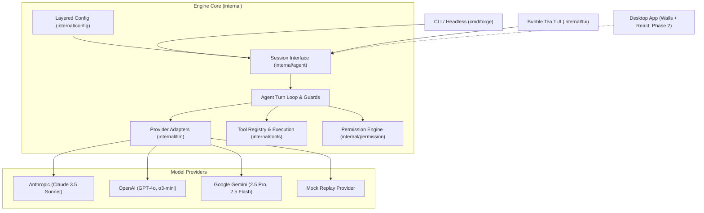
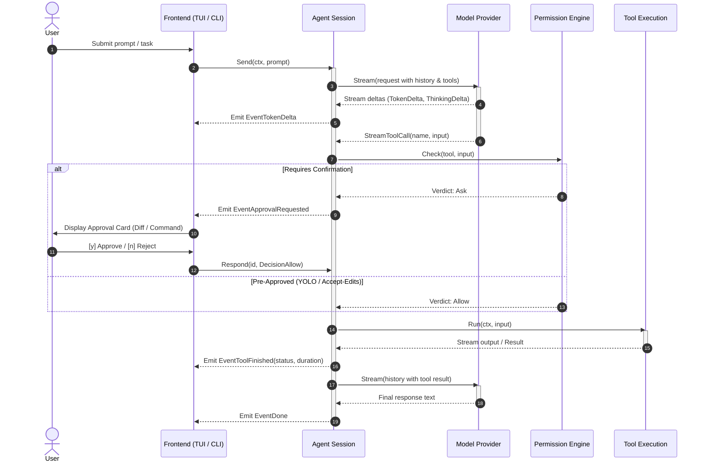

# Forge Architecture & System Design

Forge is a provider-agnostic, terminal-first AI coding agent engineered in Go. It is architected around a strict decoupled design: a headless, UI-independent agent core interacting with frontends exclusively through a typed, JSON-serializable `Session` and `Event` stream.

---

## 1. System Architecture Overview

---

## 2. Core Design Invariants

1. **Zero UI Imports in Core**: Packages under `internal/agent`, `internal/llm`, `internal/tools`, and `internal/permission` never import Bubble Tea, lipgloss, termenv, Wails, or any UI package.
2. **Typed Event Stream**: The engine communicates with frontends exclusively through `Event` structs (`SPEC.md §6.4`). All event payloads are flat, JSON-tagged, and serializable to facilitate TypeScript type generation.
3. **Strict Context Propagation**: Every long-running operation takes `context.Context` and honors cancellation immediately. Cancelling halts active model requests, interrupts tool child processes, and leaves conversation history in a valid state.
4. **History Integrity**: Every tool call initiated by a model turn produces exactly one tool result message in the transcript, even when cancelled or rejected, preventing model transcript corruption.
5. **Defense in Depth**: File contents, tool outputs, and command stdout are treated as untrusted data, never as system instructions (`SEC-1`).

---

## 3. Subsystem Breakdown

### 3.1 Agent Core (`internal/agent`)
- **`Session`**: The stateful engine interface exposing `Send(ctx, prompt)`, `Events() <-chan Event`, `Respond(id, decision)`, `Cancel()`, `Mode()`, and `SetMode()`.
- **Turn Loop**: Implements the iterative model-call → tool-execution → model-verification cycle.
- **Runaway Loop Guard (`A-5`)**: Halts execution if identical tool calls are dispatched consecutively without progress.
- **Fix Loop Stall Guard**: Tracks test failures against file edits; aborts if the same command fails 3 times with identical edits.
- **Error Classifier**: Maps raw provider and runtime errors into typed error codes (`ErrCodeAuth`, `ErrCodeRateLimit`, `ErrCodeContextLength`, `ErrCodeNetwork`) with actionable user guidance.
- **Secret Redaction**: Strips API keys, OAuth tokens, and bearer credentials from error strings, logs, and events.

### 3.2 LLM Providers (`internal/llm`)
- **`Provider` Interface**: Unified contract for streaming completions: `Stream(ctx, Request) (<-chan StreamEvent, error)`.
- **Multi-Provider Support**:
  - `anthropic`: Raw SSE streaming client for Claude 3.5 Sonnet.
  - `openai`: SSE streaming client supporting tool call delta chunk reconstruction for GPT-4o and o3-mini.
  - `gemini`: SSE streaming client for Google Gemini 2.5 Pro and Gemini 2.5 Flash.
  - `mock`: In-memory scripted transcript replayer enabling comprehensive deterministic offline testing.
- **Resilience (`internal/llm/retry`)**:
  - Exponential backoff with 50% random jitter.
  - Automatic handling of HTTP 429 (Rate Limit), 529 (Overloaded), and 5xx errors.
  - Strict adherence to `Retry-After` HTTP headers.
  - Transient retry notifications emitted via `EventRetryScheduled`.

### 3.3 Tools Engine (`internal/tools`)
- **`Tool` Interface**: `Name()`, `Description()`, `Schema()`, `NeedsApproval()`, `Run(ctx, input)`.
- **Read-Only Suite**:
  - `read_file`: Line-offset range reads with head/tail truncation.
  - `list_dir`: Traverses directories with `.gitignore` awareness.
  - `grep`: Fast ripgrep-style substring and regex search.
  - `glob`: Fast globbing patterns.
- **Mutation Suite**:
  - `write_file`: File creation with automatic parent directory creation.
  - `edit_file`: Exact matching single-occurrence string replacement (`old_string` → `new_string`).
- **Shell Execution (`bash`)**:
  - Native shell detection (`pwsh` -> `powershell.exe` -> `cmd.exe` on Windows; `$SHELL` -> `/bin/sh` on Unix).
  - Child process environment sanitization: strips `*_API_KEY`, `*_TOKEN`, `*_SECRET`; injects `CI=1`, `NO_COLOR=1`.
  - Standard input closed (`bytes.NewReader(nil)`) to prevent indefinite terminal hangs.
  - Process tree termination via Windows Job Objects and POSIX process groups. On Windows the shell is created suspended and resumed only after `AssignProcessToJobObject`, because Go's `SysProcAttr` cannot create the process inside the job directly. If that assignment fails, the process is killed and the command returns an error. Closing the job handle kills the tree (`JOB_OBJECT_LIMIT_KILL_ON_JOB_CLOSE`). This is not a sandbox.

### 3.4 Permissions & Safety (`internal/permission`)
- **Policy Modes**:
  - `ask`: Every mutating action (file write, file edit, command execution) requires explicit human confirmation.
  - `accept-edits`: File writes and edits proceed automatically; bash commands require confirmation.
  - `plan`: Read-only mode; all write and execution tools are strictly blocked.
  - `yolo`: Auto-approves file edits and safe commands; dangerous commands still prompt for confirmation.
- **Dangerous Command Detection (`SEC-3`)**:
  - Heuristic pattern matching for catastrophic operations: recursive root deletion (`rm -rf /`, `rd /s`), raw disk writes (`dd`), destructive Git commands (`git push --force`, `git reset --hard`, `git clean -fd`), remote code execution (`curl|sh`, `iwr|iex`), broad permissions (`chmod -R /`), and tampering with `.git/` or credential stores (`.env*`, `.ssh`, `.aws`).
  - Labeled explicitly as a speed bump, not an airtight sandbox.

### 3.5 Layered Configuration (`internal/config`)
- Loads and merges configuration in priority order:
  1. CLI Flags (`--provider`, `--model`, `--theme`, etc.)
  2. Environment Variables (`FORGE_*`)
  3. Project Configuration (`<root>/.forge/config.json`)
  4. User Configuration (`~/.forge/config.json`)
  5. Built-in Defaults
- **SEC-6 Enforcement**: Emits prominent security warnings if credentials or API keys are placed in project configuration files.

---

## 4. Execution Flow

