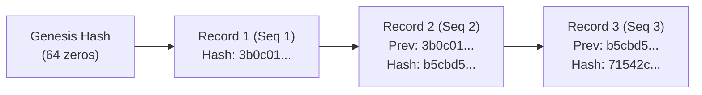

# Forge Audit Logging & Tamper Evidence Guide

Forge provides an immutable, tamper-evident audit log system (`SPEC §3.3 P-7`) that records every tool request, human approval decision, and execution result.

---

## 1. Storage & Privacy Model

### Location and Permissions
- **User Data Directory Only**: Audit logs are stored in `~/.forge/audit/<workspaceHash>.jsonl` (never inside the workspace directory).
- **Strict File Permissions**: Audit files are opened with mode `0600` (readable and writable only by the current user).
- **Append-Only**: Every event is appended immediately using `os.O_APPEND` with immediate flushes.

### Zero Secrets Leaked
Audit logs pass all text through Forge's high-confidence secret redactor:
- API keys (OpenAI, Anthropic, Gemini, Google, AWS, GitHub) are replaced with `[REDACTED:<type>]`.
- **Never Stores Raw Content or Diffs**: For file edits, the audit log records only the file path, before/after SHA-256 hashes, and line change counts.
- **Never Stores Raw Tool Output**: For command execution, the audit log stores only the command (redacted), exit code, duration in milliseconds, output byte size, and the SHA-256 digest of the output.

---

## 2. Record Structure

Each line in the `.jsonl` audit file represents an audit record:

```json
{
  "timestamp": "2026-11-13T14:27:23.6240391Z",
  "session_id": "s_1731508043621",
  "seq": 1,
  "event": "decision",
  "tool": "bash",
  "action_summary": "go test ./...",
  "decision": "allow",
  "decision_source": "rule:bash(go test:*)",
  "prev_sha256": "0000000000000000000000000000000000000000000000000000000000000000",
  "record_sha256": "3b0c010b0b90592471845112fa68427f71b9f67a2139e6a0d4c885fa2ef19934"
}
```

### Fields

| Field | Type | Description |
| :--- | :--- | :--- |
| `timestamp` | `string` | ISO 8601 / RFC 3339 UTC timestamp with nanosecond precision. |
| `session_id` | `string` | Unique session identifier. |
| `seq` | `integer` | 1-based monotonically increasing sequence number per session. |
| `event` | `string` | Event type: `tool_requested`, `decision`, or `tool_result`. |
| `tool` | `string` | Name of the tool invoked (`bash`, `edit_file`, `write_file`, `read_file`). |
| `action_summary` | `string` | Redacted command or file modification summary. |
| `decision` | `string` | Decision verdict: `allow` or `deny`. |
| `decision_source` | `string` | Source of decision: `rule:<text>`, `floor`, `mode`, `user`, `user-feedback`, `session`, or `headless-auto-deny`. |
| `exit_code` | `integer` | Process exit status code (0 for success). |
| `duration_ms` | `integer` | Execution duration in milliseconds. |
| `output_size` | `integer` | Number of bytes generated in tool stdout/stderr. |
| `output_sha256` | `string` | Hexadecimal SHA-256 digest of tool output. |
| `prev_sha256` | `string` | SHA-256 digest of previous record for the same session. |
| `record_sha256` | `string` | SHA-256 digest of this canonical record payload. |

---

## 3. Cryptographic Tamper Evidence

To ensure the log cannot be silently altered or reordered, Forge implements a per-session SHA-256 hash chain:



1. **Genesis Link**: The first record of a session links to 64 zeros (`0000000000000000000000000000000000000000000000000000000000000000`).
2. **Chain Continuation**: Every subsequent record stores the SHA-256 digest of the previous record of the same session in `prev_sha256`.
3. **Internal Hash**: `record_sha256` is computed over the canonical JSON of the record itself.

### Verification (`forge audit verify`)
Running `forge audit verify` audits the log against three invariant checks:
- **Modification Check**: If any field (timestamp, command, decision, tool) in a record is modified, its internal hash no longer matches `record_sha256`.
- **Deletion Check**: If any record is removed, the sequence number jumps and `prev_sha256` breaks.
- **Reordering Check**: If records are swapped or rearranged, the hash chain is invalidated.

> [!NOTE]
> **Tamper-Evident vs Tamper-Proof**:
> Forge's audit log is **tamper-evident**, not tamper-proof.
> Any process with file-write permissions on your disk could rewrite the entire file from scratch.
> However, any modification, deletion, or reordering of historical records without recalculating every downstream record hash will be immediately detected and reported.

---

## 4. Configuration & Failure Handling

Audit logging is configured in `~/.forge/config.json` (user config only; project repositories cannot configure or alter audit settings):

```json
{
  "audit": {
    "enabled": true,
    "path": "~/.forge/audit/custom.jsonl",
    "max_mb": 50,
    "required": false
  }
}
```

### Log Rotation
When the audit log reaches `max_mb` (default 50 MB), Forge automatically rotates it to `<path>.<unix_timestamp>`.
The per-session cryptographic hash chains seamlessly continue across rotated files.

### Failure Modes (`audit.required`)
- **Default (`audit.required: false`)**: If the audit file cannot be written (e.g. disk full or read-only filesystem), Forge emits a visible warning to `stderr` and continues execution (fail-open).
- **Compliant (`audit.required: true`)**: If audit writing fails, tool execution is blocked and denied immediately (fail-closed).

---

## 5. CLI Commands

### Inspect Audit Records
```bash
# View recent audit events
forge audit show

# View recent events for a specific session
forge audit show --session s_1731508043621 --tail 20
```

### Verify Integrity
```bash
forge audit verify
```
Exit codes:
- `0`: Integrity verified successfully. All record hashes and chains intact.
- `1`: **Tampering detected.** The exact line number, session ID, and mismatch details are reported.
